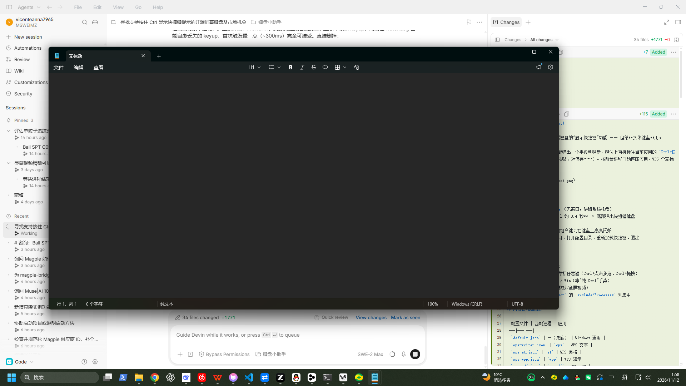
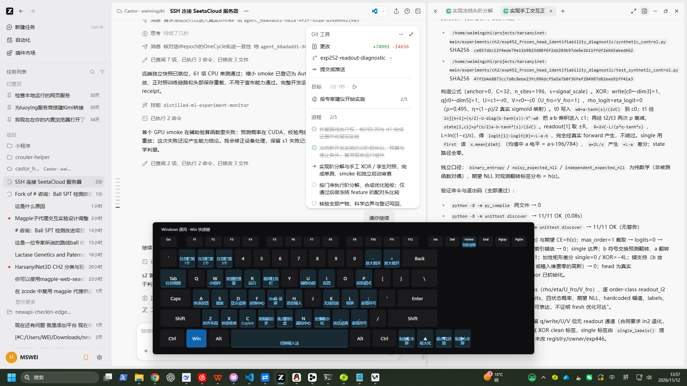

# 键盘小助手 (KeyboardHint)

仿华为 MateBook Fold 虚拟键盘的"显示快捷键"功能 —— 但给**实体键盘**用。

**按住 Ctrl / Alt / Win 不放，屏幕底部弹出一个亚克力质感键盘，键位上直接标注当前应用的对应快捷键**（Ctrl+C=复制、Alt+F4=关闭、Win+E=资源管理器……）。Fluent Design 风格：DWM 背景模糊、原生圆角、上浮淡入动画。按前台进程自动匹配应用，WPS 全家桶优先适配。



按住 Win 的效果（松手不弹开始菜单）：



## 使用方式

1. 启动 `KeyboardHint.exe`（**单文件**，约 69MB，无需安装运行时、无需附带目录，双击即用，驻留系统托盘）
2. 在任意应用中**按住修饰键**：
   - **Ctrl** ≈0.4s → 当前应用的 Ctrl+ 快捷键
   - **Win** ≈0.6s → Windows 系统快捷键（松手**不会**弹开始菜单）
   - **Alt** ≈0.4s → Alt 组合 / Office·WPS 功能区快捷键提示
   - **Shift** 默认关闭（快捷键太少；托盘或设置里可开）
3. **弹出后加按其他修饰键** → 切到组合层（`Ctrl+Shift`、`Win+Shift`、`Ctrl+Alt`……），修饰键高亮；松开回到基础层
4. 松开触发键 → 键盘隐藏；按住时实际按下的组合键会在键盘上闪烁
5. **钉住模式**（默认关）：松开后保持显示，再按一次触发键关闭 —— 适合当速查卡片用
6. 托盘图标右键：**设置窗口**（启用/开机自启/触发键勾选/延迟/透明度/钉住/排除进程/主题/强调色）、**快捷键编辑器**（可视化编辑任意应用的快捷键，无需手写 JSON；也可 `KeyboardHint.exe --editor` 直接打开）、自定义当前应用快捷键（JSON 导出，供高级用户）、打开配置目录、重新加载快捷键、退出
7. 首次启动会弹气泡提示用法（只弹一次）
8. **换肤**：设置窗口里选 深色/浅色 主题 + 8 种强调色（蓝/紫/绿/橙/粉/青/红/金），保存即生效不用重启；也可直接改 `settings.json` 的 `theme`/`accent` 字段

### 防误触发

以下情况**不会**弹出键盘：
- 按住修饰键的同时按住了鼠标任意键或滚动滚轮（Ctrl+点击多选、Ctrl+滚轮缩放）；已弹出时再点按也会隐藏
- 弹出之前同时按住了**其他**修饰键（非"纯按住"手势，避免切输入法/AltGr 等组合误触发；**弹出之后**再加按则是切层）
- 前台是无边框全屏应用（游戏/全屏视频）
- 前台进程在 `settings.json` 的 `excludedProcesses` 列表中
- Alt+Shift / Ctrl+Space 等输入法组合、AltGr（国际键盘=Ctrl+Alt）不会弹

### Win/Alt 松手副作用的处理

长按 Win 弹层后，本应用向系统注入一个未使用的 `F24` 虚拟键，让 Windows 认为这次按键属于组合键 —— 松开 Win **不会**弹开始菜单，松开 Alt **不会**抢走菜单栏焦点。不吞任何真实按键（吞 keyup 会让 `GetAsyncKeyState` 卡死）。

## 内置快捷键配置

| 配置文件 | 匹配进程 | 应用 |
|---|---|---|
| `default.json` | —（兜底） | Windows 通用 |
| `wps-writer.json` | `wps` | WPS 文字 |
| `wps-et.json` | `et` | WPS 表格 |
| `wps-wpp.json` | `wpp` | WPS 演示 |
| `wps-pdf.json` | `wpspdf` | WPS PDF |
| `msoffice-word.json` | `winword` | Word |
| `msoffice-excel.json` | `excel` | Excel |
| `msoffice-ppt.json` | `powerpnt` | PowerPoint |
| `browser.json` | `chrome` `2345explorer` `theworld` `liebao` `maxthon` `ucbrowser` | Chromium 系浏览器（兜底） |
| `vscode.json` | `code` | VS Code |
| `visualstudio.json` | `devenv` | Visual Studio |
| `jetbrains.json` | `idea64` `pycharm64` `webstorm64` `goland64` `clion64` `rider64` `datagrip64` `phpstorm64` `studio64` `rubymine64` 等 | JetBrains 全家桶 / Android Studio |
| `notepadpp.json` | `notepad++` | Notepad++ |
| `sublime.json` | `sublime_text` | Sublime Text |
| `explorer.json` | `explorer` | 资源管理器 |
| `terminal.json` | `windowsterminal` `wt` `warp` | Windows Terminal |
| `wechat.json` | `wechat` `weixin` | 微信 |
| `qq.json` | `qq` `qqnt` | QQ |
| `dingtalk.json` | `dingtalk` `dingtalklite` | 钉钉 |
| `wxwork.json` | `wxwork` `wework` | 企业微信 |
| `feishu.json` | `feishu` `lark` | 飞书 |
| `jianying.json` | `jianyingpro` `capcut` `vegaspro` | 剪映 / CapCut |
| `photoshop.json` | `photoshop` | Photoshop |
| `obsidian.json` | `obsidian` | Obsidian |
| `notion.json` | `notion` | Notion |

**另内置 86 个应用专属配置**（合计 111 个 profile、约 4800 条快捷键）：

| 分类 | 应用 |
|---|---|
| 浏览器 | Edge、Firefox、Opera、Vivaldi、Brave、QQ浏览器、360安全浏览器、360极速浏览器、搜狗浏览器 |
| 开发工具 | Eclipse、NetBeans、Cursor、Atom、Zed、HBuilderX、Godot、Unity |
| 终端/数据库/网络 | Xshell、MobaXterm、FinalShell、Tabby、SecureCRT、Postman、Navicat、DBeaver、FileZilla |
| 办公/笔记/邮箱 | Outlook、OneNote、Typora、思源笔记、有道云笔记、印象笔记、XMind、Foxmail |
| Adobe/剪辑/图形 | Premiere、After Effects、Illustrator、Lightroom、Audition、DaVinci Resolve、Blender、GIMP |
| UI设计/原型 | Figma、Axure、MasterGo、Pixso、Canva、Adobe XD、Filmora、Clip Studio Paint |
| IM/会议协作 | Teams、Slack、Discord、Telegram、TIM、Zoom、腾讯会议、Skype |
| 播放器/录制/音频 | PotPlayer、VLC、MPC-HC、OBS、Bandicam、Audacity、网易云音乐、QQ音乐、foobar2000 |
| 效率/文件/截图 | Snipaste、PixPin、ShareX、Everything、Total Commander、Directory Opus、XYplorer、Beyond Compare、WinMerge |
| PDF/远程/下载 | Acrobat、福昕PDF、SumatraPDF、ToDesk、TeamViewer、AnyDesk、向日葵、远程桌面、百度网盘、迅雷 |

层数据：`default.json` 带 `ctrl`/`ctrl+shift`/`alt`/`alt+shift`/`shift`/`win`/`win+ctrl`/`win+shift` 八层（win/alt 为系统级，**所有应用自动继承**——应用没定义某层时回落到 default 的同层）；应用配置普遍带 `ctrl`/`ctrl+shift`/`ctrl+alt`，浏览器/资源管理器/Office/WPS 等带应用专属 `alt` 层（含功能区 KeyTips）。

### 添加自己的应用

最方便的方式：托盘菜单 → **快捷键编辑器…** —— 选应用、选修饰层（Ctrl / Ctrl+Shift / Alt …），在表格里直接"选按键 + 填说明"，无需手写 JSON。支持**新建应用**（自动预填当前前台进程名）和**导入 .json 配置**。保存即写入用户目录并热加载。

也可直接运行 `KeyboardHint.exe --editor` 单独打开编辑器（托盘常驻时不冲突，编辑后到托盘"重新加载快捷键配置"生效）。

高级用户仍可用托盘 → **自定义当前应用快捷键（JSON）…** 导出原始 JSON 编辑。

手动放 JSON 的三个位置（后者覆盖前者同名 id）：
- exe **内嵌资源** —— 111 个内置配置，不可见不可改
- `exe目录\shortcuts\*.json` —— 便携/开发模式覆盖
- `%LOCALAPPDATA%\KeyboardHint\shortcuts\*.json` —— 用户自定义（托盘菜单可一键打开目录）

格式：

```json
{
  "id": "myapp",
  "displayName": "我的应用",
  "processes": ["myapp"],
  "layers": {
    "ctrl": {
      "S": "保存",
      "F5": "刷新"
    },
    "ctrl+shift": {
      "S": "另存为"
    },
    "ctrl+alt": {
      "V": "选择性粘贴"
    }
  }
}
```

`processes` 填进程名（不含 `.exe`，任务管理器→详细信息里看）。`layers` 下可配任意修饰键组合层，命名按 `win` < `ctrl` < `alt` < `shift` 顺序用 `+` 连接：`ctrl`、`alt`、`win`、`shift`、`ctrl+shift`、`ctrl+alt`、`alt+shift`、`win+shift`、`win+ctrl`、`ctrl+alt+shift`……应用没定义的层自动回落到 `default` 同层，都没有则显示"暂无数据"。每层的键是**键 ID**：

- 字母：`A`–`Z`；数字：`D0`–`D9`（`D1`=主键区1）；功能键：`F1`–`F12`
- 符号：`Oem3`(`) `OemMinus`(-) `OemPlus`(=) `Oem4`([) `Oem6`(]) `Oem5`(\\) `Oem1`(;) `Oem7`(') `OemComma`(,) `OemPeriod`(.) `Oem2`(/)
- 其他：`Esc` `Tab` `Caps` `Back` `Enter` `Space` `Ins` `Del` `Home` `End` `PgUp` `PgDn` `Left` `Up` `Down` `Right`
- 修饰键：`LControl` `RControl` `LShift` `RShift` `LAlt` `RAlt` `LWin` `RWin`

改完后托盘菜单点"重新加载快捷键配置"即可，不用重启。

## 设置 `settings.json`

同目录覆盖顺序：`%LOCALAPPDATA%\KeyboardHint\settings.json` > `exe目录\settings.json`。托盘菜单→"设置…"有图形界面可直接改。

```json
{
  "enabled": true,
  "delayMs": 200,
  "opacity": 0.92,
  "stayOnRelease": false,
  "renderMode": "software",
  "theme": "dark",
  "accent": "#60CDFF",
  "triggers": {
    "ctrl":  { "enabled": true },
    "alt":   { "enabled": true, "suppressRelease": true },
    "win":   { "enabled": true, "delayMs": 350, "suppressRelease": true },
    "shift": { "enabled": false }
  },
  "excludedProcesses": ["game1", "game2"]
}
```

- `delayMs`：按住修饰键多久后弹出（150ms 起，默认 200ms）；`triggers.*.delayMs` 可给某个键单独设（Win 默认 350ms 防误触）
- `triggers`：每个修饰键独立开关；`suppressRelease` = 按住时注入 F24 哑键，松开不算单独按键（Win 防开始菜单、Alt 防菜单栏抢焦点）
- `stayOnRelease`：钉住模式，松开后保持显示，再按一次触发键关闭
- `opacity`：键盘整体不透明度 0–1
- `renderMode`：`software`（默认）或 `hardware`。GPU/D3D 管线异常的机器上硬件渲染会让所有 WPF 窗口完全不绘制（窗口存在但内容空白）；软件渲染对这种小弹窗无性能差别且稳定。改完需重启
- `theme`：`dark`（默认）或 `light`，键盘面板深浅主题
- `accent`：标注/高亮强调色，任意十六进制色值（如 `#FF7A00`）；设置窗口提供 8 种预设
- `excludedProcesses`：永不弹出的进程名列表

## 构建

需要 .NET 8 SDK：

```powershell
dotnet build KeyboardHint.sln -c Release

# 发布（自包含真单文件：托管+原生+快捷键数据全部内嵌，约 69MB，下载即用）
dotnet publish src\KeyboardHint\KeyboardHint.csproj -c Release -o publish
```

测试触发（模拟按住 Ctrl 1 秒）：`powershell scripts\hold-ctrl.ps1 1000`

## 技术说明

- **被动监听**：`WH_KEYBOARD_LL`/`WH_MOUSE_LL` 低级钩子只观察、永远放行（`CallNextHookEx`），不吞键、不记录、不上传任何按键内容 —— 不是键盘记录器。Win/Alt 松手副作用改用注入未映射 `F24` 键化解，不吞真实按键
- **多修饰键状态机**：每个修饰键独立 pending/延迟，弹出后按其他修饰键切组合层；层数据先查应用 profile，缺失回落 `default` 同层
- 前台应用识别：`GetForegroundWindow` + 进程名匹配；`MonitorFromWindow` 定位到前台窗口所在显示器
- 全屏检测：窗口覆盖整个显示器且无标题栏样式（`WS_CAPTION`）才视为独占全屏，普通最大化不受影响
- 单实例（Mutex）、PerMonitorV2 DPI 感知、无主进程依赖

## 已知限制 / Roadmap

- 支持的触发键：Ctrl / Alt / Win / Shift（后两者经由 `triggers` 配置开关）；Shift 长按 8 秒会触发系统粘滞键提示，属 Windows 行为
- 不能点击键位直接触发快捷键（二期：overlay 需切换 `IsHitTestVisible` + `SendInput`）
- 序列式快捷键（Ctrl+K,C 先按组合再按字母）暂无法表达 —— schema 是修饰键层模型；Roadmap：chord 前缀层
- Roadmap：快捷键浏览/搜索窗口（列出当前应用全部层，可搜索可练习）
- Office/WPS 的 `alt` 层 KeyTips 字母按功能区惯例整理，个别版本可能有出入 —— 应用自身按 Alt 时也会显示原生提示，可对照
- 杀软可能因键盘钩子误报 —— 代码开源可自证；如需分发建议做代码签名
- 未签名 exe 首次运行 Windows SmartScreen 会提示，点"仍要运行"

## License

MIT
